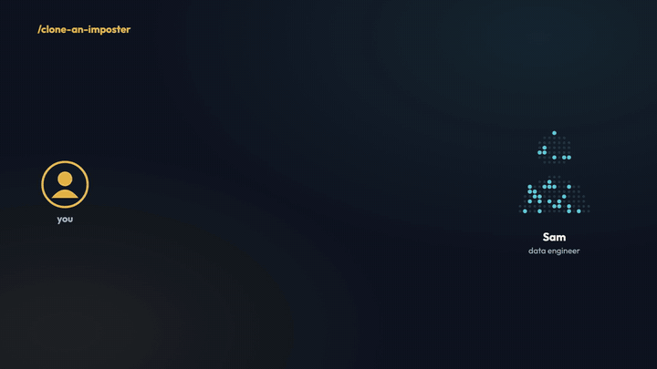

# clone-an-imposter

A Claude Code skill that builds a private AI stand-in for one colleague you work with often, from evidence of what
they actually said and did. The stand-in becomes its own command, `/imposter-<name>`.

> **Renamed in 0.3.0.** `imposter-colleague` is now `clone-an-imposter`. The stand-ins it builds keep their
> `/imposter-<name>` names. If you installed the plugin before, remove the old one first: `claude plugin uninstall
> imposter-colleague@wan-huiyan-imposter-colleague`, then `claude plugin marketplace remove wan-huiyan-imposter-colleague`,
> then install as below. `marketplace add` alone keeps the old cached name.

[](https://github.com/wan-huiyan/clone-an-imposter/actions/workflows/test.yml)




53-second demo ([MP4, full resolution](docs/demo.mp4)). "Sam" and every question in it are examples.

## Why

Many questions you send a busy colleague are not theirs (what a field *means* is a business question, not one for the
engineer who imported it), or you could answer them yourself with one command they would have run anyway. A stand-in
built from their real words filters those out. The questions that are left reach them the way they like: one topic, the
exact table, what you already checked.

## Quick start

```
You:    /clone-an-imposter build a stand-in for Sam, our data engineer
Claude: Lists the sources (your DM with Sam, the project channel, the cloud audit log),
        reads each one, merges them, checks every quote, and writes
        ~/.claude/skills/imposter-sam/SKILL.md + profile.md

You:    /imposter-sam why is the orders table half empty this morning?
Claude: (runs the read-only row-count check first, then answers the way Sam would)
        — Stand-in answer, not Sam. Route: Sam. Based on: live check + profile §4.
          Confidence: from evidence (dated). Ask the real Sam? only if it is still short after 09:00.
```

## Install

**Plugin install (recommended)**

```bash
claude plugin marketplace add wan-huiyan/clone-an-imposter
claude plugin install clone-an-imposter@wan-huiyan-clone-an-imposter
```

**Manual copy**

```bash
git clone https://github.com/wan-huiyan/clone-an-imposter.git /tmp/clone-an-imposter
cp -R /tmp/clone-an-imposter/plugins/clone-an-imposter/skills/clone-an-imposter ~/.claude/skills/
```

Then, in any Claude Code session: `/clone-an-imposter build a stand-in for <name>`.

## What you get

For each colleague, two private files in `~/.claude/skills/imposter-<name>/`:

| File | What it holds |
|---|---|
| `SKILL.md` | The `/imposter-<name>` command: read the profile, classify the question, check live state, answer, add the stand-in footer; or pre-read a draft you are about to send them |
| `profile.md` | Who they are, what they own, what is not theirs and who to ask instead, how they reason, read-only live checks, voice, an impersonation brief, how to ask them, open questions, where the stand-in is weakest, fixed test questions |

Every claim in the profile carries a dated quote or a log line; anything else is marked **inferred**.

## How it works

| Step | What happens | Time |
|---|---|---|
| 1. List sources | Your DM, group chats, shared channels, a work log you both appear in (audit log, Git history, ticket tracker) | 5 min |
| 2. Read | One reader per source, each returning the same five lists: does, does not, good questions, deflected, tone | 30–45 min |
| 3. Merge | A fresh agent merges the lists, keeping disagreements between sources visible | 10 min |
| 4. Check | Evidence check (is every quote real and dated?) and fairness check (would they call it unfair?) | 15 min |
| 5. Write | The two files | 10 min |
| 6. Test | Three questions you already know the answer to, saved and re-asked after every refresh | 5 min |

## Ground rules the skill enforces

- **Tell the colleague first.** If they say no, stop. Show them the profile if they ask; delete it if they ask.
- **Private.** The profile never goes in a repo or a shared folder. Share this skill, never your `imposter-<name>` folder.
- **It never speaks for them.** No messages sent, no "X says…" in decks or tickets, never a stand-in for their approval.
- **Your own access only.** Chats you are in, logs you may already read.
- **Work behaviour only.** No health, family, money, complaints about others, or anything said in confidence.

## Limitations

- It is only as good as the chats and logs you can read. A colleague you mostly talk to in person will have a thin profile.
- It goes stale as people change roles. Refresh when an answer turns out wrong or every couple of months.
- It cannot tell you what the colleague *thinks* of something they have never discussed. It says so and points you to the real person.
- Live checks need the same read access the colleague's systems give you; without it, answers fall back to the profile and are marked inferred.

## Requirements

- Claude Code with a chat connector (Slack or Teams), or exported chats saved as files.
- Read access to at least one work log you both appear in.
- Subagents (the Agent tool) make step 2 faster, but you can also read the sources one at a time.

## Related

- [no-ask-left-behind](https://github.com/wan-huiyan/no-ask-left-behind): its `imposter-client` skill builds AI clients for *client* people and uses them to review a deliverable before the client sees it. Several ideas here came from it.

## Version history

- **0.3.0** (2026-11-26): renamed from `imposter-colleague`. From `imposter-client`: raw transcripts over AI summaries, an impersonation brief in the profile, fixed test questions re-asked after each refresh, a backup before each refresh, pre-reading a draft in a fresh subagent, reader count and tier stated before launching.
- **0.2.0** (2026-11-25): first shared version. Steps for someone new, ground rules on consent and privacy, examples from a pilot stand-in for a data engineer.

## License

MIT
